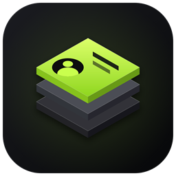
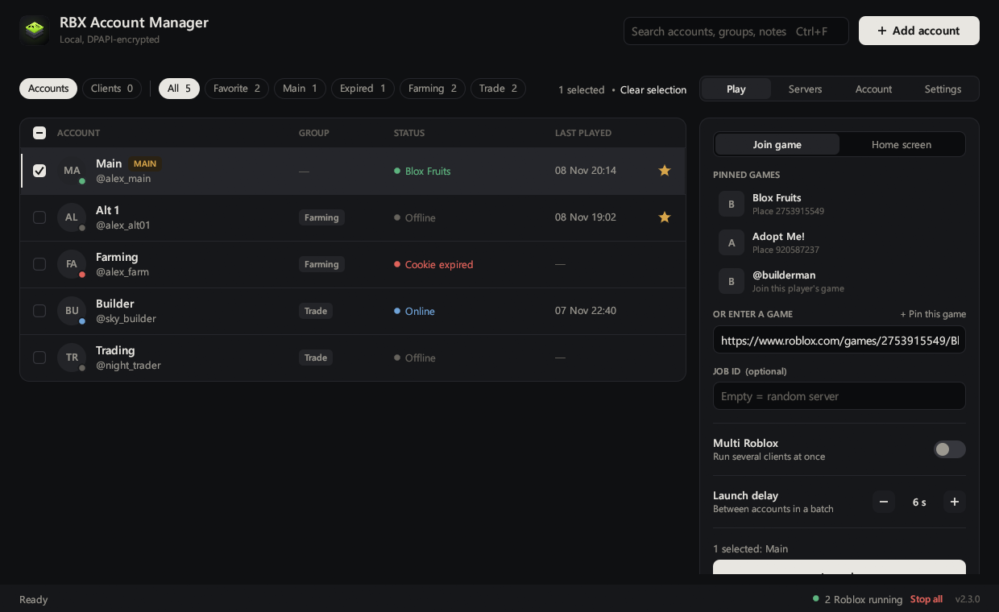

<p align="center"></p>

# RBX Account Manager

A small, local Roblox account manager for Windows, written in Rust with [egui](https://github.com/emilk/egui).

Your accounts are encrypted with Windows DPAPI and stored only on your PC. The app talks to `roblox.com` (and `rbxcdn.com` for avatar and game images) and nothing else.



## Download

Grab `RBXAccountManager.exe` from the [latest release](https://github.com/rafaelvons/rbx-account-manager/releases/latest). It's a single file, no installer. Windows SmartScreen may warn the first time because the exe isn't code-signed: click **More info → Run anyway**.

## Features

**Accounts**
- Add an account by pasting its `.ROBLOSECURITY` cookie, or paste many cookies at once (one per line, `username:cookie` works too)
- Import from Roblox Account Manager's `AccountData.json`, including the passwords it saved (the original file is never modified)
- Aliases, groups, notes, favorites and a **MAIN** flag (MAIN accounts are skipped by "select all")
- Optional saved password per account: hidden until you click **Show**, with a **Copy** button
- Filter by favorites, MAIN, expired or group, plus search
- Live presence (online / in game / in Studio) and real avatar headshots
- Account details: Robux, Premium, friends, followers, following, join date
- Check every account's cookie at once

**Launching**
- Join a game from a game link, Place ID, private server link, `roblox.com/share` link, `roblox://` link, profile link or `@username` (follows that player)
- Or open Roblox on the **home screen**, signed in, without joining a game
- Pinned games with names and icons, plus recent games
- Multi Roblox: run several clients side by side
- Batch launch with an adjustable delay, a cancel button, and automatic re-selection of accounts that didn't launch
- Public server browser (sort by players or ping) and joining a specific server
- Running client counter and "stop all Roblox"

**Clients & automation**
- **Live previews** of every running Roblox client (Windows DWM thumbnails, no screen capture), with Focus and Close buttons
- **Anti-AFK**: taps F13 in each client every 5–19 minutes so Roblox doesn't kick it for idling. It waits for a short pause in your own typing first
- **Auto-rejoin (beta)**: watches each client's Roblox log for disconnects, kicks and shutdowns and rejoins automatically. Stops after 3 rejoins in 10 minutes
- **FPS limit**: sets Roblox's own Maximum Frame Rate (`FramerateCap` in `GlobalBasicSettings_*.xml`) and the `DFIntTaskSchedulerTargetFps` fast flag before every launch and rejoin. Other settings are kept
- **Close to tray**: the X button hides the app; Anti-AFK and auto-rejoin keep running. The tray menu has Show, Anti-AFK, Stop all Roblox and Quit
- **Discord**: Rich Presence works out of the box (on by default, turn it off in Settings) and shows the app plus how many clients are running on your profile. Optional webhook alerts for disconnects, rejoins and finished batches. Advanced: use your own Discord Application ID to show a different name

**Lightweight**
- Single ~7 MB `.exe`, no installer
- Hands unused memory back to Windows when minimized or idle (about 4–10 MB in Task Manager)

## Security model

- Cookies and saved passwords are encrypted with [DPAPI](https://learn.microsoft.com/windows/win32/api/dpapi/) (current user scope). Only the Windows user that saved them, on the same PC, can decrypt `accounts.dat`.
- Data lives in `%LOCALAPPDATA%\LocalRbxManager\`.
- Cookies are never shown again after being saved, and are only sent to `roblox.com`.
- Saved passwords are hidden until you click **Show** and are never sent anywhere: the app signs in with the cookie, not the password. A password you change on roblox.com isn't updated here automatically.
- **Never share your `.ROBLOSECURITY` cookie.** Anyone who has it can sign in to your account.

## Getting a cookie

1. Open an Incognito window and sign in to roblox.com with the account.
2. Press F12 and open **Application → Cookies → https://www.roblox.com**.
3. Copy the value of `.ROBLOSECURITY` and paste it into the app.
4. Close the Incognito window. Don't click **Log out**, that invalidates the cookie.

## Building

Requirements: Windows 10/11 and Rust with the GNU toolchain (no Visual Studio needed).

```powershell
rustup-init.exe --default-host x86_64-pc-windows-gnu --profile minimal
```

Then run:

```powershell
.\build.bat
```

The result is `dist\RBXAccountManager.exe`.

Notes:
- `Cargo.lock` pins a few dependencies (`parking_lot`, `native-tls`, `schannel`, `webbrowser`, …) to versions that don't need `dlltool`, so the self-contained GNU toolchain can build without MinGW or MSVC. Keep the lock file when updating.
- `build.ps1` generates `linklibs\libshlwapi.a` from the cargo registry on the first build.

### Developer flags

| Flag | What it does |
|---|---|
| `--demo` | Shows fake demo accounts (nothing is saved) |
| `--screenshot <file.png>` | Renders the window to a PNG and exits |
| `--tab servers` / `--tab detail` / `--tab settings` | Opens on that tab |
| `--clients` | Opens the live client previews |
| `--home` | Starts in home-screen launch mode |
| `--show-add` / `--show-bulk` / `--show-import` | Opens that dialog |

Set `RBXMGR_DATADIR` to use a different data folder (handy for testing).

Run the unit tests with `cargo test --release` (they never touch your real Roblox install or accounts).

## Privacy

Besides `roblox.com`/`rbxcdn.com`, the app only talks to Discord: Rich Presence goes to the Discord app running on your own PC (it shows the number of accounts and running clients, never names or cookies), and webhook alerts go to your own webhook if you turn them on.

## Disclaimer

This project is not affiliated with or endorsed by Roblox Corporation. Use it at your own risk and follow the [Roblox Terms of Use](https://en.help.roblox.com/hc/en-us/articles/115004647846).

## License

[MIT](LICENSE)
